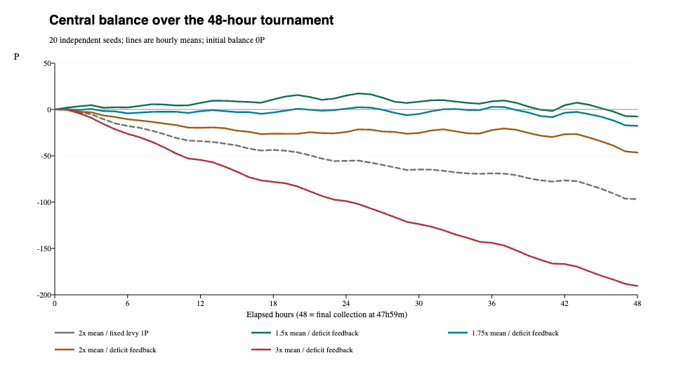

# セントラル方式のシミュレーション（2026-10-13）

その後のユーザー説明により、セントラルの赤字は進行を阻害せず、評価目的は取引・投稿・テイク・ドロー等の活動量と再分配へ更新された。本稿の収支重視の判断は当時の検討履歴。最新は[準備金・発行・ショップ比較](tricks-central-liquidity-report-2026-10-13.md)。

## 結論

ユーザー指定の全員1P補償＋順位ウェイト2:1を前提に、セントラル方式を実験用シミュレーターへ実装した。**レア度ボーナスの8P上限は採用していない**。正式ルール・本番・校正済みシミュレーター本体は未変更。

セントラルの収支は、赤字時の徴収率だけでなく、平均残高から何倍離れた人を徴収対象にするかに大きく依存した。20共通seedでは平均1.5倍の案は中盤に黒字を保つが終盤に赤字へ戻りやすく、平均2倍・3倍の案ではほぼ大会中ずっと赤字だった。平均1.5倍への広い徴収はドローを約28.5%減らし、本人のテイクコストに満たない状態の滞在時間を増やした。**会計の安定と、プレイヤーの参加資金の確保を同時に満たす案は、この範囲では確認できなかった**。



図は各条件20seedの毎時平均。1.5x/1.75x/2x/3xは平均所持DPの倍率。赤字連動は赤字15Pごとに徴収額を1P増やす。点の間は線で結んだ参考推移で、個別大会のスロット間の正確な段差は実験JSONの台帳に保存している。48時間の点は47時間59分の閉幕回収後。

## 実装したルール・未指定事項の仮定

- セントラルは大会単位の残高Zを持ち、開始Z=0P、負残高を許容。徴収・返却費・同点端数を収入とし、定期支給・空場緊急支給・1P保証の不足を支出とする。回収時にセントラル全額を札へ移す旧ポットの動作を廃止。
- 定期支給は現行の毎時00分/30分に1Pずつ。参加済みの各人について `所持DP＋手札枚数 < 本人の次回テイクコスト` のとき支給し、セントラルから同額を差し引く。支給間隔や1回の支給量を変更する指示ではないため、即時の不足全額給付にはしていない。
- テイクコストは現行モデルの `2+floor(sqrt(成功テイク回数))` 枚。所持DP＋手札は、DPを手札へ交換できる資源の指標であり、実際のテイク操作には必要枚数の手札が必要。
- テイク・無料初投稿直前の合計5未満に対する即時1P支給を廃止。初期参加5P・後発参加時の既存参加者への1Pは今回の変更対象ではなく、新規発行のまま維持した。
- 空場かつ全参加者がそれぞれ本人のテイクコスト未満の場合の緊急補充も、同じ基準までの不足をセントラルが負担。今回の実験では発生0件。空場支給を継続する解釈であり、ユーザーの6項目に明記のなかった部分の仮定として区別する。
- 回収原資は投稿者N≥1なら `A=S+B+C`。セントラル残高は原資へ合算しない。`F=max(0,N−A)` をセントラルが支払い、`Q=A+F` を全員最低1P＋残りの順位ウェイト2:1で配分。N=0なら還元・補償なし。Cは投稿/延長の実払い、Bは現行レア度ボーナスで上限なし。
- 同点は占有順位枠を合算し整数均等配分。端数はセントラルへ戻す。今回の連続スコア試行では同点端数0Pだったが、単体検査で均等・整数総額保存を確認。

徴収ボーダー・赤字連動の係数は未指定なので以下を仮定した。

```text
給付後・徴収前の参加済み全プレイヤーの平均所持DP = μ
徴収ボーダー = α × max(μ, 0)
対象者 = 所持DPがボーダーを厳密に超える人

Z ≥ 0：名目徴収額 t = 1P
Z < 0：名目徴収額 t = 1 + ceil((-Z) / d) P

実徴収額 = min(t, 所持DP − floor(ボーダー))
```

α=1.5/1.75/2/3は平均に対する乖離率50%/75%/100%/200%。平均は手札を含まないDPの算術平均で、登録済みの非活動中プレイヤーと負残高も含める。平均0以下では乖離率が定義しにくいため、0Pボーダーに置き換え、正DPの人だけを対象にする。負平均の対応はユーザー指定ではなく本実験のフォールバック。

dは15P/30Pを予備比較し、本比較では15Pを使った。例としてZ=−1〜−15Pならt=2、−16〜−30Pならt=3。スロットごとのμ・Z・tを固定して全員を同時判定し、後の対象者の処理順でボーダーや税額が変わらないようにした。対象者を徴収ボーダーの床値より貧しくしないため実徴収額を保護している。名目tが18Pでも実徴収18Pとは限らず、対象者がいなければ徴収は0P。実徴収保護も追加仮定であり、負残高をプレイヤーへ転嫁する徴収案は今回実装していない。

## 比較条件

匿名大会ログで校正済みの15人、Ko/A/T/Ku・実測P04・中位5・下位5。G参加は今回の比較に含めない。47時間59分、初期160枚、開始19時間後160枚補充（時刻はリプレイ境界による推定）。活動時間・実力・試行係数・実測頻度によるソフトな行動選好を固定した。投稿・更新のDP負債は現行モデルどおり許容する。

予備探索は8条件×5seed（262000〜262004）＝40大会。本比較は対照＋5方式×未使用20seed（262100〜262119）＝120大会。計160条件試行。平均1.75倍案は予備結果から追加した中間案で、同じ未使用20seedへ適用した。比較の対照は**全員1P配分のみを採用し、旧給付・即時支給・レベル徴収・ポット一括配布を残したモデル**。「徴収1P固定」のセントラル案は赤字連動だけを除いた追加対照。

資金不足時間は、参加登録中に `DP＋手札 < 本人のテイクコスト` だった時間の合計。実プレイ時間や実際にブロックされた操作時間そのものではなく、非活動時間も含む状態滞在の代理指標。旧3P未満の指標もJSONに残すが、今回の効果判断では本人のテイクコストを使う。

## セントラル残高：20seed平均

| 方式 | 終了残高P | 各大会最低残高の平均P | 赤字時間h | 時間加重平均P | 徴収P | 定期支給P | 1P不足補填P |
|---|---:|---:|---:|---:|---:|---:|---:|
| 平均2倍・徴収1P固定（対照） | -96.75 | -98.85 | 46.44 | -50.79 | 160.15 | 240.65 | 16.55 |
| 平均1.5倍・赤字連動 | -7.55 | -15.15 | 5.76 | 6.73 | 329.25 | 316.75 | 20.10 |
| 平均1.75倍・赤字連動 | -17.65 | -23.45 | 25.71 | -2.59 | 288.50 | 287.40 | 19.05 |
| 平均2倍・赤字連動 | -46.40 | -52.50 | 44.63 | -21.79 | 238.20 | 267.50 | 17.25 |
| 平均3倍・赤字連動 | -190.45 | -191.80 | 46.63 | -97.66 | 58.10 | 231.25 | 17.80 |

上の最低残高は各seedの全入出金イベントでの最低値を平均したもの。平均曲線の最低値とは異なる。給付後・徴収前の一時的な赤字も最小値へ含めるが、同時刻に回復した赤字の滞在時間は0。

| 方式 | 0h | 6h | 12h | 18h | 24h | 30h | 36h | 42h | 閉幕 |
|---|---:|---:|---:|---:|---:|---:|---:|---:|---:|
| 平均2倍・徴収1P固定（対照） | 0.00 | -17.80 | -34.15 | -43.65 | -55.50 | -64.75 | -68.90 | -76.55 | -96.75 |
| 平均1.5倍・赤字連動 | 0.00 | 2.20 | 7.10 | 10.85 | 15.00 | 8.40 | 8.75 | 4.55 | -7.55 |
| 平均1.75倍・赤字連動 | 0.00 | -4.15 | -1.85 | -3.25 | 0.85 | -4.90 | 2.80 | -3.60 | -17.65 |
| 平均2倍・赤字連動 | 0.00 | -10.50 | -19.75 | -26.10 | -24.35 | -25.40 | -22.30 | -26.70 | -46.40 |
| 平均3倍・赤字連動 | 0.00 | -26.25 | -54.45 | -78.10 | -98.90 | -123.70 | -143.95 | -166.80 | -190.45 |

平均1.5倍案の終了残高は−25〜＋15P、20大会中14大会が赤字終了。中盤24hには平均＋15Pまで回復したが、最後の6hで定期支給55.00P＋不足補填4.25Pに対し徴収47.15Pとなり、12.10P減った。平均1.75倍案は終了−40〜＋4P、19/20大会が赤字。こちらも最後の6hに約14.05P減った。**中盤に黒字でも、終盤の支給継続・閉幕回収時の不足補填まで賄えるとは限らない**。

平均2倍・赤字連動案は−85〜−9P、平均3倍案は−241〜−148Pで全大会赤字終了。3倍案は名目徴収額が最大18Pへ上がったが、76.8%のスロットで徴収者0人だった。平均2倍では徴収者0人のスロット27.3%、1.5倍では2.6%。赤字が増えるほど名目徴収を増やしても、徴収対象者やボーダー超過分がなければ支出を賄えない。

## プレイヤーへの影響：20seed平均

| 方式 | ドロー | 初投稿 | 下位初投稿 | 回収 | 全員テイク資源不足h | 下位資源不足h | プレイヤーDP負債h | 終了所持DP計 |
|---|---:|---:|---:|---:|---:|---:|---:|---:|
| 配分変更のみ・旧給付/ポット | 912.70 | 477.10 | 52.60 | 158.25 | 79.86 | 3.32 | 17.43 | 300.85 |
| 平均2倍・徴収1P固定（対照） | 791.85 | 473.75 | 51.65 | 154.75 | 110.67 | 6.15 | 24.46 | 193.90 |
| 平均1.5倍・赤字連動 | 652.75 | 463.85 | 52.55 | 145.15 | 148.05 | 12.99 | 24.46 | 128.70 |
| 平均1.75倍・赤字連動 | 696.60 | 471.20 | 51.30 | 148.75 | 131.78 | 9.58 | 24.32 | 141.80 |
| 平均2倍・赤字連動 | 720.60 | 473.10 | 51.55 | 150.40 | 122.67 | 7.71 | 23.68 | 152.05 |
| 平均3倍・赤字連動 | 814.70 | 481.20 | 54.30 | 156.10 | 105.84 | 5.50 | 23.61 | 288.05 |

平均1.5倍案は対照比でドロー−28.5%、初投稿−2.8%、全員テイク資源不足時間＋85.4%、下位不足時間約3.32→12.99h。平均2倍案はドロー−21.1%、下位不足時間約3.32→7.71h。3倍案はドロー−10.7%に留まるが、セントラルの大幅赤字による貸し出しがその資金を支えており、無条件に望ましい結果ではない。

初投稿数の差がドローほど大きくない理由の一つは、ネームド4人の実測操作頻度へのソフトな選好と、投稿/更新の負債許容が残るため。参加者の心理や今後の大会の参加増減を確定する予測として使わない。行動モデルには新徴収を予見してDPを手札へ退避する等の徴収回避戦略を追加していない。今回の結果は既存の行動選好が、実際の残高・給付・徴収へ反応した場合の比較である。徴収範囲を広げればセントラル会計は安定するが、プレイヤーの資金が減り、原資S+Bを生むテイク/回収も減る。名目徴収額の増加は単純な収入の増加とはならない。

## 会計確認と資金の意味

セントラルの残高式は

```text
Z = 開始残高0 + 徴収 + 返却費 + 同点端数
    − 定期支給 − 緊急支給 − 1P不足補填
```

不足補填は最下位の1P全額ではなく、札のS+B+Cを全員へ最低1P配るのに不足する分だけ。定期支給の方が大きな支出となり、例えば平均1.5倍案では支出336.85Pのうち316.75P（94.0%）が定期支給。全員1P補償だけがセントラル赤字の主因ではない。

回収報酬そのものは原資S+B+Cから出るため、セントラルを全額配ることはない。返却費と同点端数は実験では微小で、持続的な主要財源とはならなかった。閉幕残高は全額プレイヤーへ精算せず、赤字も残す。初期セントラルに準備金を置く案は今回未比較であり、曲線へ準備金を単純加算するだけの予測はできない（Zの符号で徴収率・行動が変わるため）。

全Central試行で、セントラル残高＝収支台帳の合計、即時支給0、ポット一括配布0、最下位0P0件を確認。閉幕時に独立した貨幣収支

```text
プレイヤー所持DP合計＋セントラル残高
= 初期/後発参加の新規発行＋投稿あり回収のS+B
  − ドロー支出−無投稿回収の未還元支払い
```

を照合し、誤差0。給付・徴収・1P不足補填を新規発行へ二重計上していない。全既存不変条件・固定チェックに加え、徴収境界、負平均フォールバック、同一スロットの固定判定、中央資金による定期/緊急/保証支給、即時支給廃止、整数配分と同点端数保存を検査した。

## 判断・次の検証

本案は「セントラルが負債も負担して給付する」という会計として整合した。ただし、対象を平均2〜3倍へ絞るとこの条件では資金不足、1.5倍まで広げると会計改善と引き換えにプレイヤーの流動性が低下した。今回の範囲から特定の徴収率を正式採用値として選ばない。

調整を続ける場合は、次の項目を別々に検証する。

1. 定期支給対象を参加登録者全員にするか、実際に再参加可能な人へ絞るか。今回の支給は活動中かどうかを問わない。
2. 徴収ボーダーがDP平均だけで適切か。手札へ支出している人とDPを貯める人の差、平均0付近への対応、ボーダー超過分の保護を確認する。
3. 閉幕前の準備金と、負残高を何Pまで許容するか。準備金は一時的な赤字を防ぐが、恒常的な赤字の解決ではない。
4. 即時支給廃止・旧ポット回収廃止・支給閾値変更を1つずつ切り替える対照。今回の新方式は複数変更の合成であり、悪化を1項目だけの因果と断定しない。

本体の5人以上の配分差は前回同様、実験用サブクラスでは本番に合わせ、校正済み本体のSHAを保持した。新しい給付と徴収の心理的効果はログから直接推定できておらず、別大会・別seed・意欲モデルの感度分析での再確認が必要。

## 再現・成果物

- [実験スクリプト](../scripts/study-tricks-central.py)：Central方式と旧方式対照を切り替えて再実行できる。
- [20seed検証JSON](tricks-central-validation-2026-10-13.json)：各大会の全入出金台帳、各徴収スロットの平均/ボーダー/名目徴収額、毎時平均・最小・最大、プレイヤー資源、共通seed差。
- [予備探索JSON](tricks-central-screen-2026-10-13.json)：1.5/2/3倍、赤字15/30P単位の比較。
- [残高グラフ](tricks-central-balance-2026-10-13.svg)、[グラフ再生成](../scripts/render-tricks-central.py)。

```bash
python3 next/pages/limited/tricks/docs/scripts/study-tricks-central.py \
  --runs 20 --seed 262100 \
  --cases pot_smooth central_fixed_2x central_1.5x_d15 central_1.75x_d15 central_2x_d15 central_3x_d15 \
  --output /private/tmp/tricks-central-check.json
```

返却・匿名プレイヤー・操作頻度は大会分析から校正したモデルを使用し、実ユーザーの認証情報・生ログ本文・内部監査情報を成果物へ転記しない。今回の変更は実験用スクリプトと研究文書に限る。
